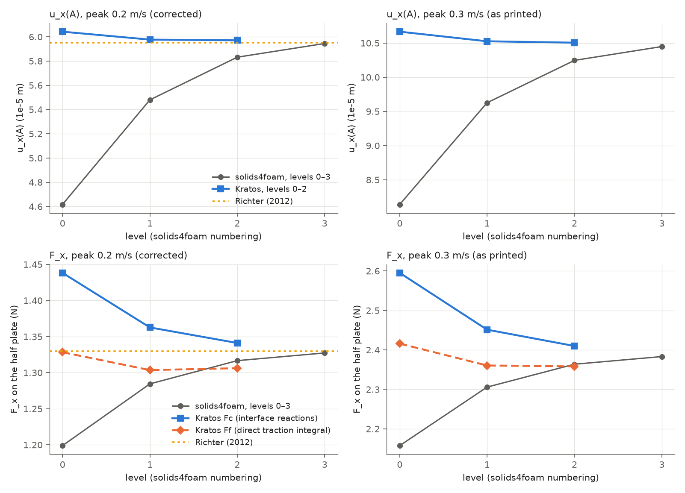
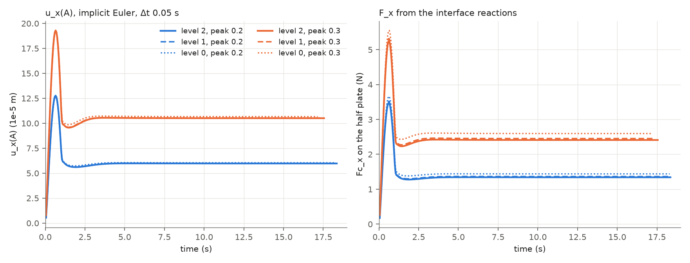

# beamInCrossFlow with Kratos Multiphysics (levels 0 to 2)

An independent-code solution of the steady beam in cross-flow of Richter (2012, Section 6.2) for
`app:beam`. Kratos shares no code with solids4foam. This folder holds the input generator, the run
scripts, every run's history with its coupling record, the steady values, a static check of the plate
and the figures. No `.tex` file is changed. The discussion is in issue #36.

**Main results.**

- **u_x(A).** With the corrected 0.2 m/s peak, Kratos level 2 gives 5.970e-5 m. That is 0.34% above
  Richter's 5.95e-5 m, 0.44% above solids4foam's level 3 and 0.46% below solids4foam's conditional
  Richardson value from levels 1–3 (`../beam_richter_findings.md`). With the printed 0.3 m/s peak it is
  0.54% above level 3 and 0.39% below the Richardson value. At both peaks Kratos levels 1 and 2 lie
  between solids4foam's level 3 and its extrapolated value.
- **From level 0 to level 2.** Kratos u_x(A) falls by 1.1% and then 0.10% (0.2), and by 1.3% and then
  0.19% (0.3), while solids4foam rises by 19% and 18% from level 0 to level 1.
- **F_x.** Kratos gives two estimates, one from the interface reactions (Fc) and one from a direct
  traction integral (Ff). At levels 1 and 2 the spread between them contains solids4foam's level 3 at
  both peaks and Richter's value at 0.2 m/s, and it shrinks from level to level (0.110, 0.059 and
  0.035 N at 0.2). Fc falls monotonically, and its conditional Richardson value from levels 0–2 (1.3324
  and 2.3931 N, order 1.8) is within 0.01% of solids4foam's (1.3325 and 2.3928 N).
- **The two inflows.** The ratio of the 0.3 and 0.2 m/s results at level 2 is 1.759 for u_x(A) and 1.80
  (Fc) or 1.81 (Ff) for F_x, against 1.758 and 1.796 in solids4foam. An independent code is thus
  consistent with Richter's values only with the 0.2 m/s peak, which is the corrected inflow of
  `app:beam`.

## Code and platform

- Kratos Multiphysics 10.3.0 from PyPI (KratosMultiphysics, KratosFSIApplication,
  KratosFluidDynamicsApplication, KratosStructuralMechanicsApplication, KratosMeshMovingApplication,
  KratosMappingApplication and KratosLinearSolversApplication, all 10.3.0) with CPython 3.11.18, as for
  `../kratos_mok_lid_driven_cavity/`.
- The same UCD workstation, an Intel i9-10900X (10 cores) with 62 GB and Ubuntu 18.04.6, running OpenMP
  with 1 thread (level 0), 2 threads (level 1) or 8 threads (level 2). Every run's `run_info.json`
  records the version string, host, CPU and thread count, and `time.txt` the wall time and peak memory.
- The definition and the mesh family follow solids4foam's verification campaign (branch
  `verification/beam-richter`, `tutorials/fluidSolidInteraction/beamInCrossFlow/verification/scripts/richter_case.py`,
  commit `7e8cd7379`). The solids4foam values compared here are those of `../beam_richter/`
  (`r02_sequence.csv`, `production_sequence.csv`, `solid_static.csv`).

## Problem and discretisation

- **Geometry.** The half domain z ≤ 0 with a symmetry plane at z = 0, as in solids4foam. The duct is
  (0, 1.5) × (0, 0.4) × (−0.4, 0) m and the plate (0.4, 0.5) × (0, 0.2) × (−0.2, 0) m, clamped at y = 0.
  Point A = (0.45, 0.15, −0.15) m is a plate node at every level.
- **Mesh.** solids4foam's graded block family with the production thickness multiplier 2. Per direction
  the blocks share their divisions and gradings, so the fluid is one graded tensor-product grid with the
  plate cells removed. In x it has 12f cells (ratio 1/8), 8f across the plate and 24f (ratio 8); in y
  8f below the plate top and 6f above (ratio 6); in z 6f (ratio 1/6) and 8f beside the plate. Each fluid
  hexahedron is split into 6 tetrahedra (two prisms of three tetrahedra, minimum-index rule,
  conforming). The plate is 8f × 8f × 8f hexahedra. Fluid and plate nodes coincide on the interface.

  | Level | Factor f | Fluid hexahedra (solids4foam) | Fluid tetrahedra | Fluid nodes | Plate hexahedra |
  |---|---|---|---|---|---|
  | 0 | 1 | 8 112 | 48 672 | 9 677 | 512 |
  | 1 | 2 | 64 896 | 389 376 | 71 009 | 4 096 |
  | 2 | 4 | 519 168 | 3 115 008 | 543 329 | 32 768 |

- **Fluid.** ρ_f = 1000 kg/m³ and ν_f = 1e-3 m²/s. QSVMS P1/P1 tetrahedra with `dynamic_tau = 0`, so
  the stabilisation parameter, and therefore the steady state, do not depend on Δt. Newton tolerance
  1e-8 (relative), AMGCL 1e-10.
- **Plate.** `TotalLagrangianElement3D8N` with `LinearElastic3DLaw`, which with the Green–Lagrange strain
  gives S = C : E, the St Venant–Kirchhoff law. E = 1.4 MPa, ν = 0.4 and ρ_s = 1000 kg/m³ (irrelevant at
  steady state). Newton tolerance 1e-9 (relative). Levels 0 and 1 use Kratos's default direct solver
  (`sparse_lu`). It is single-threaded and slow for the about 108 000 plate DOFs of level 2, so level 2
  uses CG with AMG (`--structure-solver amgcl`, tolerance 1e-12), checked against the direct solve at
  level 0 (see Checks).
- **Boundary conditions.** The inlet velocity is v_x = U y (0.4 − y)(0.4² − z²)/(0.2² · 0.4²), ramped by
  (1 − cos(πt/1 s))/2 over the first second as solids4foam's `paraboloidInletVelocity`, with U = 0.2 or
  0.3 m/s. The outlet has p = 0 with natural velocity. The floor, top and side are no-slip. On the
  symmetry plane v_z, the mesh displacement u_z and the plate u_z are zero. The mesh is fixed on the rest
  of the outer boundary and moves by structural similarity.
- **Time stepping.** Implicit Euler in the fluid, the plate and the mesh velocity, to march to the steady
  state. Kratos's QSVMS scheme is BDF2-based, so `MainKratos_beam.py` overwrites its coefficients with
  [1/Δt, −1/Δt, 0] each step and replaces the mesh velocity helper by `TimeDiscretization.BDF1()`, as for
  the 3dTube runs (`../kratos_3dtube/`, PR #92). Δt = 0.05 s. A run stops once u_x(A) and Fc_x change by
  less than 1e-6 (relative) over 1 s, after at least 4 s, which happens at 17 to 19 s.
- **Coupling.** Dirichlet–Neumann with MVQN (full Jacobian) at the Kratos 10.3.0 default settings. The
  input sets only `solver_type`, which leaves `w_0 = 0.825` and `abs_cut_off_tol = 1e-8`. A step is
  converged when the RMS interface displacement residual |r|/√n_DOF is below 1e-10 m (about 2e-6 of
  u_x(A)), with at most 50 iterations. Every step of every run met it.
- **Force on the half plate.** `Fr` is minus the sum of the fluid REACTION over the interface nodes,
  which is the load the coupling gives the plate. At the nodes of the plate base edge (y = 0) it also
  contains the share of the floor traction next to the edge, which goes into the clamp. `Fc`, the primary
  value, is `Fr` minus that share, computed from the P1 velocity gradient and the linear pressure of the
  floor faces at the edge. `Ff` is the direct integral of the traction over the wetted plate faces from the
  same P1 fields, which is solids4foam's definition. Fc is the consistent nodal load; Ff uses a velocity
  gradient that is constant in each tetrahedron.
- **Histories.** At every step, `history.csv` records u(A), the three force estimates, the coupling
  solves, the converged flag, the residual at acceptance and the inlet peak velocity of the ramp.

## Checks

- **Plate alone** (`scripts/solid_static_check.py`, `checks/solid_static/`). A uniform 100 Pa in +x on the
  upstream face, as solids4foam's `solid_discretisation.py`. u_x(A) is 1.3107e-4, 1.3752e-4 and
  1.3996e-4 m at factors 1, 2 and 4, against solids4foam's 1.2394e-4, 1.3510e-4 and 1.3952e-4 m (family m2)
  and about 1.41e-4 m converged. Both converge from below, and the hexahedra are less stiff than the
  finite volume plate at the coarse levels (+5.8%, +1.8%, +0.3%).
- **Time step.** At level 0 (peak 0.2), Δt = 0.1 s changes the steady u_x(A) by 9e-9 and F_x by at most
  1.6e-7 (relative) against Δt = 0.05 s.
- **Repeatability.** The three level-0 runs were run twice, on 10 and 11 November, before and after a
  restart of the workstation (`runs/_first_pass/`). Their histories are identical in every column except
  the step wall time.
- **Plate solver.** At level 0 (peak 0.2), CG with AMG (`runs/f1_U0.2_dt0.05_amg`) reproduces the
  direct solve. u_x(A) differs by at most 1.2e-15 m over the run, the steady values by less than 1e-11
  (relative), and the coupling solves are the same in all 366 steps.
- **Fluid linear solver.** In the level-2 run at 0.2 m/s the fluid AMGCL solve ended above its 1e-10
  tolerance 113 times in 91 steps: 61 times at most 1e-9 and 46 times between 1e-9 and 1e-8. The six
  larger ones, up to 1.3e-2, are all in the step at t = 4.45 s, inside the fluid Newton loop, whose
  convergence is not logged (echo level 0). The coupling converged in that step, and u_x(A) and Fc_x are
  smooth through it. No other run has such warnings.
- **Steady state.** Over the last second of each run u_x(A) and Fc_x change by 4.6e-7 to 1.0e-6 (relative).

## Results

Kratos levels 0 to 2 against the solids4foam sequence (`tab:beam_seq`) and Richter (2012). F_x on the
half plate. Full tables, with u_y(A), u_z(A), F_y and F_z, are in `results/summary.md`.

| | u_x(A), 0.2 (1e-5 m) | F_x, 0.2 (N) | u_x(A), 0.3 (1e-5 m) | F_x, 0.3 (N) |
|---|---|---|---|---|
| Kratos 0 | 6.0418 | Fc 1.4382, Ff 1.3283 | 10.6653 | Fc 2.5951, Ff 2.4159 |
| Kratos 1 | 5.9764 | Fc 1.3626, Ff 1.3035 | 10.5249 | Fc 2.4512, Ff 2.3604 |
| Kratos 2 | 5.9704 | Fc 1.3410, Ff 1.3061 | 10.5046 | Fc 2.4098, Ff 2.3581 |
| Kratos, conditional Richardson from levels 0–2 | 5.9698 (order 3.5) | Fc 1.3324 (order 1.8) | 10.5011 (order 2.8) | Fc 2.3931 (order 1.8) |
| solids4foam 0 | 4.6168 | 1.1988 | 8.1392 | 2.1574 |
| solids4foam 1 | 5.4793 | 1.2844 | 9.6261 | 2.3057 |
| solids4foam 2 | 5.8312 | 1.3166 | 10.2455 | 2.3636 |
| solids4foam 3 | 5.9443 | 1.3272 | 10.4478 | 2.3831 |
| solids4foam, conditional Richardson from levels 1–3 | 5.9978 | 1.3325 | 10.5459 | 2.3928 |
| Richter (2012) | 5.95 | 1.33 | – | – |



- **u_x(A).** Kratos level 2 is within 0.44% (0.2) and 0.54% (0.3) of solids4foam's level 3 and within
  0.34% of Richter. The solids4foam Richardson values are conditional (`app:beam`), and Kratos level 2 is
  within 0.5% of them at both peaks. The Kratos changes fall faster than second order (observed orders
  3.5 and 2.8), so the Kratos sequence is not shown to be asymptotic and its Richardson values for
  u_x(A) are conditional too.
- **Why the codes move in opposite directions.** At 0.2 m/s, from level 0 to level 1 the plate alone becomes 4.9%
  more compliant in Kratos and 9.0% in solids4foam, while the force on the plate falls by 5.3% in Kratos
  (Fc) and rises by 7.1% in solids4foam. The products, −0.6% and +16.8%, give the direction and most of
  the size of the u_x(A) changes (−1.1% and +18.7%). So the direction comes from the fluid force.
- **F_x.** At level 2 Fc is 1.0% (0.2) and 1.1% (0.3) above solids4foam's level 3 and Ff is 1.6% and
  1.0% below it. Fc − Ff falls from 0.110 to 0.059 and 0.035 N (0.2) and from 0.179 to 0.091 and
  0.052 N (0.3). Fc falls by 5.3–5.5% and then 1.6–1.7%, which gives an observed order of 1.8 at both
  peaks. Ff falls by 1.9–2.3% from level 0 to level 1 and then changes by +0.20% (0.2) and −0.10% (0.3),
  so it is not monotone at 0.2. Fc and Ff therefore still give a spread for F_x rather than a value. The
  conditional Richardson value of Fc agrees with solids4foam's to 0.01% at both peaks.
- **Other components.** Fc_y agrees with solids4foam's level-3 F_y to 0.5% (0.2) and 0.01% (0.3). Ff_y
  does not (0.069 against 0.105 N at 0.2, 0.277 against 0.346 N at 0.3), although it moves towards it
  from level to level (0.026, 0.051 and 0.069 N at 0.2). F_y is a small net of opposing parts, so the
  slower convergence of Ff weighs more there. The transverse displacements u_y(A) and u_z(A), 1.5 to
  2.2% of u_x(A), agree with solids4foam's level 3 to 0.9–1.6% at level 2. F_z is listed in
  `results/summary.md` but not compared, because at 0.2 m/s the two Kratos estimates still differ by a
  fifth at level 2.



The overshoot during the 1 s ramp comes from the pressure gradient that accelerates the flow. It is a
start-up transient, and every run is close to steady by about 5 s.

## Runs

| Run | Level | Peak (m/s) | Δt (s) | Steps | Stopped at (s) | Coupling solves per step | Threads | Wall time (h) | Status |
|---|---|---|---|---|---|---|---|---|---|
| `f1_U0.2_dt0.05` | 0 | 0.2 | 0.05 | 366 | 18.3 | 1.51 | 1 | 0.77 | reported |
| `f2_U0.2_dt0.05` | 1 | 0.2 | 0.05 | 364 | 18.2 | 1.55 | 2 | 4.49 | reported |
| `f1_U0.3_dt0.05` | 0 | 0.3 | 0.05 | 343 | 17.15 | 1.52 | 1 | 0.73 | reported |
| `f2_U0.3_dt0.05` | 1 | 0.3 | 0.05 | 347 | 17.35 | 1.51 | 2 | 4.46 | reported |
| `f4_U0.2_dt0.05_amg` | 2 | 0.2 | 0.05 | 367 | 18.35 | 1.56 | 8 | 53.57 | reported |
| `f4_U0.3_dt0.05_amg` | 2 | 0.3 | 0.05 | 351 | 17.55 | 1.53 | 8 | 37.98 | reported |
| `f1_U0.2_dt0.1` | 0 | 0.2 | 0.1 | 188 | 18.8 | 1.37 | 1 | 0.39 | Δt check |
| `f1_U0.2_dt0.05_amg` | 0 | 0.2 | 0.05 | 366 | 18.3 | 1.51 | 1 | 0.85 | plate-solver check |
| `_first_pass/` | 0 | the three level-0 runs above, run on 10 November | | | | | 1 | | repeat check |

Peak memory is 0.35 GB at level 0, 2.0 GB at level 1 and 15.6 GB at level 2. The level-2 runs (19 to 23
November) shared the workstation with other jobs for part of the time, so their wall times overstate the
cost. Attempts that ended for other reasons are not included. These are a smoke test, two runs under
gdb and five runs that crashed on 10 November while the workstation had faulty memory (see
Limitations). Their notes stay on the workstation and are available on request.

## Files

| Path | Contents |
|---|---|
| `scripts/beam_case.py` | Writes an input set (for example `beam_case.py inputs/gen/f2_U0.2_dt0.05 --factor 2 --inlet-peak 0.2`, with `--structure-solver amgcl` for the AMG plate solve) and records its options and mesh sizes in `case.json` |
| `scripts/MainKratos_beam.py` | Runs a case with the ramped inlet, the implicit-Euler override and the steady-state stop, and writes `history.csv` and `run_info.json` |
| `scripts/run_case.sh` | `MAIN=MainKratos_beam.py scripts/run_case.sh <input dir> <run dir> <threads>` (Linux) |
| `scripts/beam_qoi.py` | `results/summary.md` and `results/steady_values.csv` |
| `scripts/plot_beam.py` | The figures (needs matplotlib) |
| `scripts/solid_static_check.py` | The plate-alone check |
| `runs/<name>/` | `history.csv`, `case.json`, the `ProjectParameters.json`, materials files and `force_faces.json` that ran, the `MainKratos_beam.py` that ran, `inputs.sha256` (including the meshes), `run_info.json`, `run_meta.txt`, `time.txt`, `log.txt` |
| `checks/solid_static/` | The plate-alone inputs (without meshes) and `solid_static_TotalLagrangianElement3D8N.json` |
| `results/` | `summary.md`, `steady_values.csv` |
| `figures/` | `levels.png`, `histories.png` |
| `SHA256SUMS` | Checksums of every file in this folder |

## Reproducing

From this folder, with Kratos 10.3.0 installed (`KRATOS_ENV` may name a script that activates it):

```bash
python scripts/beam_case.py inputs/gen/f2_U0.2_dt0.05 --factor 2 --inlet-peak 0.2
MAIN=MainKratos_beam.py scripts/run_case.sh inputs/gen/f2_U0.2_dt0.05 myruns/f2_U0.2_dt0.05 2
python scripts/solid_static_check.py mychecks 1 2 4
```

The other runs take `--factor 1`, `--factor 4`, `--inlet-peak 0.3`, `--dt 0.1` or `--structure-solver
amgcl` (the `_amg` runs); the remaining options are the defaults. On the workstation (Python 3.11.18,
glibc 2.27) the current `beam_case.py` regenerates the meshes and input files of all eight runs with the
same sha256 as in their `inputs.sha256` (which also lists the `MainKratos_beam.py` that `run_case.sh`
copies in); `case.json`
records the output path, so the input set must be written to `inputs/gen/<name>`. On macOS with
Python 3.14, 23 grid coordinates differ in the last bit (at most 4.4e-16 m, from the platform's `pow`),
which changes the level-1 fluid mesh file and a volume diagnostic in `case.json`.

The tables and figures:

```bash
python scripts/beam_qoi.py --runs runs --s4f ../beam_richter --static checks/solid_static \
    --out results/summary.md --csv results/steady_values.csv
python scripts/plot_beam.py --runs runs --s4f ../beam_richter --out figures
```

## Limitations

- Three levels. The Kratos u_x(A) changes fall faster than second order, so the sequence is not shown to
  be asymptotic, and its Richardson values are conditional, as solids4foam's are. A level 3 (factor 8,
  about 25 million tetrahedra) is out of reach on the workstation.
- The fluid stabilisation (QSVMS) and the tetrahedral fluid mesh are numerical choices that differ from
  solids4foam. The plate is the same block mesh with finite elements instead of finite volumes.
- The two force estimates differ by 2.7% (0.2) and 2.2% (0.3) at level 2, so F_x from Kratos is a
  spread rather than a value.
- The workstation showed memory errors on 10 November (ECC is disabled), with Kratos crashes between
  22:26 and 22:48 UTC. A pattern test after the restart on 11 November found no errors in 40 GB. The
  level-0 runs before and after the restart are identical. The level-1 and level-2 runs, run after the
  restart, were not repeated; the level-0 plate-solver check of 19 November reproduces the direct run of
  11 November to 1e-11.
- The VTK fields (written every 5 s) and the meshes are not included; the meshes are regenerated by
  `beam_case.py` and the fields are available on request.
